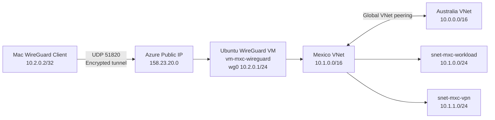
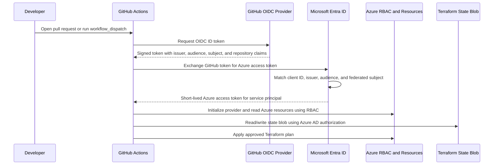
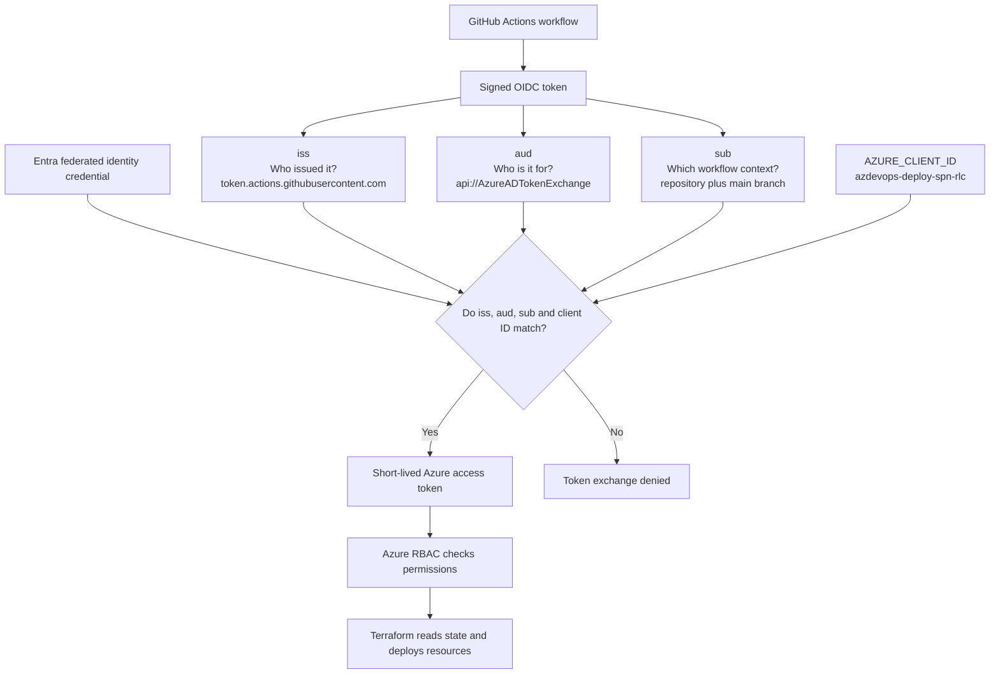

# Azure Global VNet Peering and WireGuard VM with Terraform

> **BEFORE PUBLICATION — REMOVE OR MASK:** subscription and tenant IDs; application/client ID details and service-principal name; GitHub account, repository, run-context, and OIDC subject identifiers; Azure resource-group, storage-account, container, and state-blob names; exact VNet/subnet/private IP ranges and VM/NVA names; public IP addresses and WireGuard endpoint ports; SSH usernames, fingerprints, authorized source IP ranges, and host-key details; WireGuard peer public keys, tunnel addresses, server configuration, endpoints, handshake evidence, and traffic counters; Azure region/resource topology where exposure is not intended; screenshots, logs, workflow outputs, deployment state, and any remaining credentials, tokens, private keys, or secret values. Keep private keys and tokens out of the published version entirely. The values below are retained for private operational reference only.

## Overview

This implementation deploys a WireGuard VPN appliance in Azure `mexicocentral` and peers its virtual network with an existing virtual network in `australiaeast`.

The solution uses:

- Terraform with the AzureRM provider.
- Azure Blob Storage for remote Terraform state.
- GitHub Actions for plan and apply execution.
- Microsoft Entra workload identity federation (OIDC), avoiding stored Azure client secrets.
- Ubuntu Server 24.04 running WireGuard.
- Global VNet peering for cross-region private connectivity.
- Network Security Groups and SSH public-key authentication.

> The Terraform code is the source of truth for repeatable Azure infrastructure. Some guest-OS actions, including adding additional SSH keys and the initial WireGuard client peer, were performed after provisioning through Azure VM Run Command or SSH.

## Architecture

> **#review — remove or mask:** exact public and tunnel IP addresses, VM endpoint role, region pairing, peering topology, subnet names, and any naming relationship that identifies the live environment.



### Address Plan

> **#review — remove or mask:** production regions and all exact VNet, subnet, and WireGuard overlay CIDRs. Replace them with documentation ranges or generic labels.

| Component | Location | Address |
|---|---:|---:|
| Existing Australia VNet | `australiaeast` | `10.0.0.0/16` |
| Mexico VNet | `mexicocentral` | `10.1.0.0/16` |
| Mexico workload subnet | `mexicocentral` | `10.1.0.0/24` |
| Mexico VPN subnet | `mexicocentral` | `10.1.1.0/24` |
| WireGuard tunnel network | Virtual overlay | `10.2.0.0/24` |
| WireGuard server | Ubuntu `wg0` | `10.2.0.1/24` |
| Mac WireGuard client | macOS tunnel | `10.2.0.2/32` |

The address spaces do not overlap, which is required for VNet peering.

## Repository Structure

```text
.
|-- .github/
|   `-- workflows/
|       |-- terraform-plan.yml
|       `-- terraform-apply.yml
|-- main.tf
|-- network.tf
|-- vpn.tf
|-- .gitignore
`-- bastiondeploy.json
```

### Terraform Files

- `main.tf`: configures the Azure Blob backend for Terraform state.
- `network.tf`: configures the provider, Mexico VNet, subnets, and bidirectional global peering.
- `vpn.tf`: configures the public IP, NSG, NIC, Linux VM, cloud-init, and output.

### Terraform Modules and Reusable Elements

This repository does **not** define custom child modules. It uses a single root module composed of the three Terraform files above. The main reusable platform components are:

- AzureRM Terraform provider.
- AzureRM managed resource types for networks, peerings, NSG, VM, NIC, and public IP.
- AzureRM data sources for existing resource groups, the Australia VNet, and the SSH public key.
- HashiCorp Terraform CLI installed by `hashicorp/setup-terraform@v3`.
- GitHub Actions and Azure Login reusable actions for OIDC authentication.

A future productionization could extract the VNet, NVA, and VPN peer configuration into versioned child modules.

### GitHub Actions Workflows

- `terraform-plan.yml`: validates formatting, initializes Terraform, validates the configuration, and creates a plan.
- `terraform-apply.yml`: manually triggered workflow that creates a fresh plan and applies it.

## Remote State Backend

> **#review — remove or mask:** Azure resource group, storage account, blob container, and state-file names. Do not publish Terraform state, plan files, lock data, or values recovered from state.

Terraform state is stored in the existing Azure Storage Account rather than Git.

```hcl
terraform {
  backend "azurerm" {
    # Resource group containing the storage account.
    resource_group_name  = "RGMXCFX"

    # Existing storage account and private blob container.
    storage_account_name = "samxtfstatenllmgyw6f6b7u"
    container_name       = "tfstate"

    # One state file for this deployment.
    key = "azvpn.tfstate"

    # Use Microsoft Entra tokens instead of a storage account key.
    use_azuread_auth = true
  }
}
```

The deployment identity requires `Storage Blob Data Contributor` on the state storage account. `Contributor` alone is insufficient for blob data-plane access.

> State files can contain sensitive values. They must not be committed to Git. The repository ignores `.terraform/`, `*.tfstate`, backups, lock information, and saved plans.

## Provider and Version Constraints

> **#review — remove or mask:** subscription ID, provider-registration restrictions, and any tenant or client identifiers added to this provider configuration. Version constraints may remain public.

```hcl
terraform {
  required_version = ">= 1.10.0"

  required_providers {
    azurerm = {
      source  = "hashicorp/azurerm"
      version = "~> 4.0"
    }
  }
}

provider "azurerm" {
  features {}

  # The target subscription for this deployment.
  subscription_id = "cdfa317b-7cd2-48df-a47c-98541acf6ea6"

  # The deployment identity has resource-group scope, not subscription-wide
  # permission to register every Azure resource provider.
  resource_provider_registrations = "none"
}
```

`Microsoft.Network` and any other required providers must already be registered in the subscription. The `none` setting prevents the service principal from attempting unrelated subscription-wide provider registrations.

## Mexico Network

> **#review — remove or mask:** resource-group name, exact region, VNet/subnet names, Terraform resource labels if they disclose naming conventions, and all production CIDRs.

### Resource Group Lookup

```hcl
data "azurerm_resource_group" "mexico" {
  # The resource group already exists; Terraform must not own its lifecycle.
  name = "RGMXCFX"
}
```

### VNet and Subnets

```hcl
resource "azurerm_virtual_network" "mexico" {
  name                = "vnet-mxc-vpn"
  location            = "mexicocentral"
  resource_group_name = data.azurerm_resource_group.mexico.name
  address_space       = ["10.1.0.0/16"]
}

resource "azurerm_subnet" "workload" {
  name                 = "snet-mxc-workload"
  resource_group_name  = data.azurerm_resource_group.mexico.name
  virtual_network_name = azurerm_virtual_network.mexico.name
  address_prefixes     = ["10.1.0.0/24"]
}

resource "azurerm_subnet" "vpn" {
  name                 = "snet-mxc-vpn"
  resource_group_name  = data.azurerm_resource_group.mexico.name
  virtual_network_name = azurerm_virtual_network.mexico.name
  address_prefixes     = ["10.1.1.0/24"]
}
```

The workload subnet is separate from the VPN appliance subnet to allow future NSG and route-table controls to differ by role.

## Existing Australia VNet and Peering

> **#review — remove or mask:** both region relationships, existing VNet and resource-group names, peering names, and resource IDs or address ranges implied by the peering.

The Australia VNet is read as data because it already exists outside the Terraform-owned Mexico network.

```hcl
data "azurerm_virtual_network" "australia" {
  name                = "vnet-auex-vm"
  resource_group_name = "RGAUEFAX"
}
```

Azure VNet peering is bidirectional, so each VNet needs a peering resource.

```hcl
resource "azurerm_virtual_network_peering" "mexico_to_australia" {
  name                         = "peer-mxc-to-aue"
  resource_group_name          = data.azurerm_resource_group.mexico.name
  virtual_network_name         = azurerm_virtual_network.mexico.name
  remote_virtual_network_id    = data.azurerm_virtual_network.australia.id
  allow_virtual_network_access = true

  # Required when the VPN VM forwards traffic between networks.
  allow_forwarded_traffic = true
}

resource "azurerm_virtual_network_peering" "australia_to_mexico" {
  name                      = "peer-aue-to-mxc"
  resource_group_name       = data.azurerm_virtual_network.australia.resource_group_name
  virtual_network_name      = data.azurerm_virtual_network.australia.name
  remote_virtual_network_id = azurerm_virtual_network.mexico.id

  allow_virtual_network_access = true
  allow_forwarded_traffic      = true
}
```

VNet peering itself is not transitive. Routes to `10.2.0.0/24` and return routing must be considered separately when traffic passes through the Ubuntu NVA.

## Azure SSH Public Key

> **#review — remove or mask:** SSH key resource name and resource group, administrator username, number and origin of authorized keys, key fingerprints, and references to the client machines or accounts using them.

The VM reads an existing Azure SSH Public Key resource instead of storing a public key directly in Terraform variables.

```hcl
data "azurerm_ssh_public_key" "roberto" {
  name                = "robertodefault"
  resource_group_name = "RGPKAUE"
}
```

The GitHub deployment identity has `Reader` on this individual SSH key resource so it can read the public key during planning.

> Two public keys were ultimately present in the VM guest file `/home/roberto/.ssh/authorized_keys`: the Windows key and the Mac key. Terraform currently declares the Azure-managed key; the additional Mac key was installed through Azure Run Command and should be added to infrastructure code or a configuration-management workflow if both keys must survive VM recreation.

## Network Security

> **#review — remove or mask:** public and private IP addresses, exact NSG rule numbers, open ports, SSH source CIDRs, VM NIC settings, resource names, and the fact that a specific appliance is publicly reachable.

### Public IP

```hcl
resource "azurerm_public_ip" "vpn" {
  name                = "pip-mxc-wireguard"
  location            = data.azurerm_resource_group.mexico.location
  resource_group_name = data.azurerm_resource_group.mexico.name
  allocation_method   = "Static"
  sku                 = "Standard"
}
```

The resulting public endpoint is `158.23.20.0`.

### Network Security Group

```hcl
resource "azurerm_network_security_group" "vpn" {
  name                = "nsg-mxc-wireguard"
  location            = data.azurerm_resource_group.mexico.location
  resource_group_name = data.azurerm_resource_group.mexico.name

  security_rule {
    name                   = "AllowSshFromAdminRange"
    priority               = 100
    direction              = "Inbound"
    access                 = "Allow"
    protocol               = "Tcp"
    source_port_range      = "*"
    destination_port_range = "22"

    # Known administration source ranges; SSH is not exposed globally.
    source_address_prefixes = [
      "40.77.167.0/24",
      "1.145.167.172/32"
    ]

    destination_address_prefix = "*"
  }

  security_rule {
    name                       = "AllowWireGuard"
    priority                   = 110
    direction                  = "Inbound"
    access                     = "Allow"
    protocol                   = "Udp"
    source_port_range          = "*"
    destination_port_range     = "51820"

    # WireGuard authenticates peers cryptographically, not by source IP.
    source_address_prefix      = "*"
    destination_address_prefix = "*"
  }
}
```

The SSH source addresses are operational values and may change when an administrator’s public IP changes. For production, consider Azure Bastion, a jump host, Just-In-Time VM Access, or a private management path instead of direct public SSH.

### NIC as Network Virtual Appliance

```hcl
resource "azurerm_network_interface" "vpn" {
  name                  = "nic-mxc-wireguard"
  location              = data.azurerm_resource_group.mexico.location
  resource_group_name   = data.azurerm_resource_group.mexico.name

  # Azure requires IP forwarding when this VM routes traffic onward.
  ip_forwarding_enabled = true

  ip_configuration {
    name                          = "ipconfig1"
    subnet_id                     = azurerm_subnet.vpn.id
    private_ip_address_allocation = "Dynamic"
    public_ip_address_id          = azurerm_public_ip.vpn.id
  }
}
```

IP forwarding must be enabled both at the Azure NIC and inside Linux.

## Ubuntu WireGuard VM

> **#review — remove or mask:** VM name, region, SKU availability details, administrator username, disk characteristics, cloud-init configuration, forwarding/NAT rules, generated-key paths, interface name, listening port, and tunnel address.

### VM Definition

```hcl
resource "azurerm_linux_virtual_machine" "vpn" {
  name                            = "vm-mxc-wireguard"
  location                        = data.azurerm_resource_group.mexico.location
  resource_group_name             = data.azurerm_resource_group.mexico.name
  size                            = "Standard_B2s_v2"
  admin_username                  = "roberto"
  disable_password_authentication = true
  network_interface_ids           = [azurerm_network_interface.vpn.id]

  admin_ssh_key {
    username   = "roberto"
    public_key = data.azurerm_ssh_public_key.roberto.public_key
  }

  os_disk {
    caching              = "ReadWrite"
    storage_account_type = "Standard_LRS"
  }

  source_image_reference {
    publisher = "Canonical"
    offer     = "ubuntu-24_04-lts"
    sku       = "server"
    version   = "latest"
  }
}
```

`Standard_B2s` was unavailable for the subscription in `mexicocentral`; `Standard_B2s_v2` was used instead.

### Cloud-Init Provisioning

Cloud-init installs WireGuard, enables forwarding, creates server keys, writes the initial server configuration, and starts the `wg-quick@wg0` service.

```yaml
#cloud-config
package_update: true
packages:
  - wireguard
  - iptables
runcmd:
  # Enable Linux packet forwarding persistently.
  - [ bash, -lc, "printf 'net.ipv4.ip_forward=1\n' > /etc/sysctl.d/99-wireguard.conf && sysctl --system" ]

  # Generate the server private and public keys on the VM.
  - [ bash, -lc, "umask 077; wg genkey | tee /etc/wireguard/server_private.key | wg pubkey > /etc/wireguard/server_public.key" ]

  # Create the WireGuard interface configuration.
  # The private key is read from a protected local file, not stored in Git.
  - [ bash, -lc, "PRIVATE_KEY=$(cat /etc/wireguard/server_private.key); printf '[Interface]\nAddress = 10.2.0.1/24\nListenPort = 51820\nPrivateKey = %s\n...' \"$PRIVATE_KEY\" > /etc/wireguard/wg0.conf" ]

  # Protect key and configuration material.
  - [ bash, -lc, "chmod 600 /etc/wireguard/wg0.conf /etc/wireguard/server_private.key /etc/wireguard/server_public.key" ]

  # Start the tunnel and enable it at boot.
  - [ systemctl, enable, --now, wg-quick@wg0 ]
```

The actual Terraform source contains the complete PostUp/PostDown `iptables` rules. They permit forwarding and apply source NAT for traffic leaving through `eth0`.

## WireGuard Client Peer

> **#review — remove or mask:** server and client public keys, every tunnel address, endpoint IP and port, allowed-IP routes, keepalive value, DNS choices, client platform, and all handshake or traffic evidence. Never publish a private key, even if masked elsewhere in the document.

A Mac tunnel was created with one assigned client address:

```ini
# Client-side configuration on the Mac.
[Interface]
Address = 10.2.0.2/32
PrivateKey = <kept only on the Mac>
DNS = <public DNS, or omit to preserve existing DNS>

[Peer]
PublicKey = TxxJgt/M876wUbm0YZhRt8PyNmqV6RNVWlQv+F7pPHA=
Endpoint = 158.23.20.0:51820
AllowedIPs = 10.0.0.0/16, 10.1.0.0/16, 10.2.0.0/24
PersistentKeepalive = 25
```

The server peer was persisted as:

```ini
[Peer]
PublicKey = VzBrj0re8XpOl3T1H6eBFQ0x4kvQ9lVIFh5qo/la2F0=
AllowedIPs = 10.2.0.2/32
PersistentKeepalive = 25
```

> The client private key was exposed during troubleshooting and was rotated. Never publish a WireGuard private key in chat, Git, Terraform output, or documentation.

### Tunnel Verification

> **#review — remove or mask:** peer identifiers, endpoint/socket details, timestamps, transfer counters, ping targets, service state, and any command output captured from the live VPN.

On the server:

```bash
sudo systemctl status wg-quick@wg0 --no-pager
sudo wg show
ping 10.2.0.1
```

A working peer reports:

```text
peer: VzBrj0re8XpOl3T1H6eBFQ0x4kvQ9lVIFh5qo/la2F0=
allowed ips: 10.2.0.2/32
latest handshake: <recent timestamp>
transfer: <received and sent bytes>
```

The successful endpoint showed `1.145.167.172:26628`, confirming that the client handshake reached the Azure VM.

## Split Tunnel vs Full Tunnel

> **#review — remove or mask:** exact private routes, public egress evidence, resolver addresses, tunnel mode, and public-IP behavior if they reveal the live deployment or client network.

The deployed client uses split tunneling:

```ini
AllowedIPs = 10.0.0.0/16, 10.1.0.0/16, 10.2.0.0/24
```

This means only Azure/private routes use WireGuard. Public browsing continues through the client’s normal internet gateway and public IP.

For a full tunnel, the client can instead use:

```ini
AllowedIPs = 0.0.0.0/0, ::/0
DNS = 1.1.1.1, 8.8.8.8
```

That changes the client’s externally visible IPv4 address to the VPN VM public IP, provided server forwarding, NAT, DNS, and IPv6 behavior are configured intentionally. Azure DNS `168.63.129.16` is not suitable for a normal macOS client as a public resolver.

## GitHub Actions and OIDC

> **#review — remove or mask:** GitHub organization/account and repository identifiers, tenant/subscription/client IDs, service-principal/application name, federated subject, branch/environment names, workflow triggers, repository secrets, role assignments, and any workflow-run or log identifiers. The OIDC design may be described with placeholders such as `<repository>` and `<branch>`.

### How Deployment Authentication Works

GitHub Actions does not receive an Azure client secret. It obtains short-lived credentials from Microsoft Entra ID through OpenID Connect (OIDC).



The identity involved is the **service principal** associated with the existing Microsoft Entra application `azdevops-deploy-spn-rlc`. The application registration defines how external identities can authenticate to it; the service principal is the tenant-local security principal to which Azure RBAC roles are assigned.

### Repository Secrets

The workflows store three non-secret identifiers as GitHub repository secrets:

```text
AZURE_CLIENT_ID
AZURE_TENANT_ID
AZURE_SUBSCRIPTION_ID
```

- `AZURE_CLIENT_ID` identifies the Microsoft Entra application/service principal.
- `AZURE_TENANT_ID` identifies the Microsoft Entra tenant.
- `AZURE_SUBSCRIPTION_ID` selects the Azure subscription used by the provider.

These values are not credentials by themselves. There is no `AZURE_CLIENT_SECRET`. The proof of identity is the signed, short-lived OIDC token issued specifically for the GitHub workflow run.

### Federated Identity Trust

The service principal's application has a federated identity credential that trusts GitHub's OIDC issuer. Entra validates the token and compares its claims with the registered credential.

The three values answer different security questions:

| OIDC value | Value in this deployment | Purpose |
|---|---|---|
| Issuer (`iss`) | `https://token.actions.githubusercontent.com` | Identifies who issued and signed the token. This makes Entra trust only tokens from the GitHub Actions identity provider. |
| Audience (`aud`) | `api://AzureADTokenExchange` | Identifies the intended consumer. It tells GitHub and Entra that this token is intended for an Azure token exchange, rather than another service. |
| Subject (`sub`) | `repo:allthingsdeploy@269376980/azvpn@1193408022:ref:refs/heads/main` | Identifies the exact GitHub workload: repository and workflow context. Entra allows the exchange only when this value matches the federated credential. |

The subject can be decoded as follows:

```text
repo:allthingsdeploy@269376980/azvpn@1193408022:ref:refs/heads/main
│    │                                  │              │
│    └─ GitHub repository owner/account  │              └─ Deployment branch
│                                       │
│                                       └─ Repository/job namespace encoded by GitHub
└─ GitHub workload identity prefix
```

The phrase “same subject” does **not** mean the same subject is used for every workflow. Plan and apply share this subject only because they run from the `main` branch context covered by this credential. A pull-request workflow, another branch, a fork, a tag, or a GitHub Environment normally produces a different `sub` claim and needs its own matching federated credential.



For a workflow running from `main`, the complete credential subject is:

```text
repo:allthingsdeploy@269376980/azvpn@1193408022:ref:refs/heads/main
```

The expected issuer and audience are:

```text
Issuer:   https://token.actions.githubusercontent.com
Audience: api://AzureADTokenExchange
```

Their reason for existing is prevention of token misuse:

- The **issuer** prevents another identity system from presenting a token as GitHub-issued.
- The **audience** prevents a token intended for another API from being redeemed at Entra.
- The **subject** prevents GitHub workloads outside the exact repository/branch/workflow context from impersonating this deployment.
- The **client ID** selects the Microsoft Entra application whose federated credential is being evaluated.
- Azure **RBAC** then limits the service principal even after a valid token is exchanged.

All five controls are related but have different jobs. OIDC proves the external workload's identity; the Azure client ID selects the principal; RBAC authorizes that principal's operations.

For example, a job using `environment: production` changes the `sub` claim to an environment-specific subject. The original apply job was corrected to avoid that mismatch and reuse the registered `main` branch trust. To add approval environments safely, a separate federated credential must match the environment subject, for example the corresponding `environment:production` claim.

### Workflow Permission to Mint the OIDC Token

Both workflows grant this minimal GitHub permission:

```yaml
permissions:
  contents: read
  id-token: write
```

`contents: read` allows checkout of the repository. `id-token: write` allows the runner to request the GitHub OIDC token. Without `id-token: write`, `azure/login` cannot perform the token exchange. The plan workflow additionally grants `pull-requests: write` for pull-request workflow integration, although the current steps do not post a plan comment.

### Azure Login Step

Every plan or apply job signs in independently:

```yaml
- name: Sign in to Azure with OIDC
  uses: azure/login@v2
  with:
    client-id: ${{ secrets.AZURE_CLIENT_ID }}
    tenant-id: ${{ secrets.AZURE_TENANT_ID }}
    subscription-id: ${{ secrets.AZURE_SUBSCRIPTION_ID }}
```

`azure/login@v2` asks GitHub for an OIDC token and sends it to Microsoft Entra for a workload identity exchange. If the configured claims match, Entra returns a short-lived Azure access token for the service principal. The action configures the Azure CLI and authentication environment used by subsequent provider and Terraform commands.

The token is scoped by both Azure RBAC and the selected subscription. OIDC proves who is requesting access; RBAC determines what that identity is allowed to do after authentication.

### Plan Workflow

The plan workflow runs for a pull request that changes Terraform files or its own workflow, and it can also be started manually.

```yaml
jobs:
  plan:
    runs-on: ubuntu-latest
    steps:
      - uses: actions/checkout@v4

      # Exchanges the GitHub OIDC token for an Azure access token.
      - uses: azure/login@v2
        with:
          client-id: ${{ secrets.AZURE_CLIENT_ID }}
          tenant-id: ${{ secrets.AZURE_TENANT_ID }}
          subscription-id: ${{ secrets.AZURE_SUBSCRIPTION_ID }}

      - uses: hashicorp/setup-terraform@v3
        with:
          terraform_wrapper: false

      - run: terraform fmt -check -recursive
      - run: terraform init
      - run: terraform validate
      - run: terraform plan -input=false -out=tfplan
```

The job performs these operations in order:

1. `checkout` copies the proposed repository revision to an ephemeral Ubuntu runner.
2. `azure/login` obtains and activates short-lived Azure credentials.
3. `setup-terraform` installs the Terraform CLI.
4. `terraform fmt -check` rejects incorrectly formatted HCL.
5. `terraform init` downloads the AzureRM provider and opens the Azure Blob backend.
6. Terraform reads and locks the state blob while constructing the plan.
7. `terraform validate` checks configuration and provider schema validity.
8. `terraform plan` reads current Azure resources, compares them with the desired HCL and state, and calculates `add`, `change`, and `destroy` actions.

The plan file is written only to the runner's temporary workspace. The current workflow does not upload or reuse it, and it does not perform changes to Azure.

### Apply Workflow

```yaml
on:
  workflow_dispatch:

concurrency:
  # Prevents overlapping Terraform state changes.
  group: azvpn-terraform-apply
  cancel-in-progress: false
```

Apply is a manual GitHub Actions trigger. It is not started by a push or by the plan workflow. The `concurrency` block permits only one deployment for the `azvpn-terraform-apply` group at a time and queues, rather than cancels, a second run.

The apply job checks out the selected revision, authenticates again with OIDC, initializes the same remote backend, and creates a **fresh** plan:

```bash
terraform init -input=false
terraform validate
terraform plan -input=false -out=tfplan
terraform apply -input=false -auto-approve tfplan
```

The fresh plan is important: Azure may have changed since a pull-request plan ran. `terraform apply tfplan` then executes exactly that newly generated plan, so `-auto-approve` confirms a reviewed noninteractive plan rather than causing Terraform to calculate unobserved changes at apply time.

During apply, Terraform:

1. Locks the remote state to prevent concurrent writers.
2. Determines resource dependencies from references in HCL.
3. Creates, updates, or deletes resources using AzureRM API calls.
4. Sends those calls through the identity token permissions granted to the service principal.
5. Records resource IDs and state after successful operations.
6. Releases the blob lock when execution completes.

The deployment therefore combines two controls: GitHub decides who may launch the workflow and from which revision, while Azure RBAC decides which Azure operations the resulting principal may perform.

### Why the Same Remote State Is Essential

Both workflows use the `azurerm` backend with `use_azuread_auth = true`. The backend stores `azvpn.tfstate` in the `tfstate` container. Authentication to the storage data plane also uses the principal's Azure token; it does not use a storage account key.

This shared backend gives Terraform the mapping between HCL addresses such as `azurerm_virtual_network.mexico` and existing Azure resource IDs. Without that state, a new runner would not know which resources it owns and plan behavior could become destructive or attempt duplicate names.

### Production Control Improvements

The implemented process is functional and secretless, but a stricter production deployment can add:

- A protected GitHub environment with required reviewers.
- A dedicated environment federated credential using the exact environment `sub` claim.
- Branch protection and required Terraform plan checks before merge.
- Uploading the plan as an artifact for review while still generating a fresh plan before apply.
- Read-only plan permissions and separate, more privileged apply permissions.
- Terraform policy checks and dependency scanning before apply.
- An environment-scoped deployment principal rather than one branch principal used for both plan and apply.

## Deployment Identity Permissions

> **#review — remove or mask:** principal name or ID, role scopes, subscription/resource-group/resource names, storage permissions at named scopes, and SSH-key authorization relationships.

The service principal required these permissions at the narrowest practical scopes:

| Permission | Scope | Reason |
|---|---|---|
| `Storage Blob Data Contributor` | State storage account | Read/write/lock Terraform state |
| `Contributor` | `RGMXCFX` | Create and manage Mexico resources |
| Network/VNet access | `RGAUEFAX` or the VNet | Read existing VNet and create peering |
| `Reader` | `robertodefault` SSH key resource | Read the public SSH key during plan |

The identity did not have subscription-wide resource-provider registration permissions, so automatic provider registration was disabled.

## Deployment Sequence

> **#review — remove or mask:** exact service/account names, repository and branch subjects, Azure resource names, VM SKU availability observations, IPs, paths, and descriptions of one-off guest changes that could expose the live operating procedure.

1. Create or identify the Azure Storage Account and `tfstate` container.
2. Configure the `azurerm` remote backend.
3. Use the existing `azdevops-deploy-spn-rlc` application.
4. Add the exact GitHub OIDC federated identity for `main`.
5. Add the `AZURE_CLIENT_ID`, `AZURE_TENANT_ID`, and `AZURE_SUBSCRIPTION_ID` GitHub secrets.
6. Grant storage blob data access to the service principal.
7. Add the Terraform plan workflow and validate remote-state access.
8. Deploy the Mexico VNet and two subnets.
9. Add bidirectional global peering with the Australia VNet.
10. Add the public IP, NSG, NIC, Ubuntu VM, and cloud-init provisioning.
11. Use `Standard_B2s_v2` because `Standard_B2s` was restricted in the subscription/region.
12. Add the manual apply workflow.
13. Run the plan and confirm resource additions and drift.
14. Apply from GitHub Actions.
15. Repair/extend guest SSH `authorized_keys` for both Windows and Mac clients.
16. Add the WireGuard client peer to `/etc/wireguard/wg0.conf`.
17. Restart WireGuard and verify handshake and transfer counters.

## Troubleshooting Lessons

> **#review — remove or mask:** error messages tied to named tenants/resources, exact subjects, IPs, fingerprints, failed configuration details, command history, SSH keys, endpoint sockets, handshake values, and names copied from logs or Azure responses.

### OIDC Subject Mismatch

The GitHub OIDC `sub` claim must exactly match the federated credential. A GitHub environment changes the subject from a branch-based claim to an environment-based claim.

### Azure Blob 403

A `403 AuthorizationPermissionMismatch` from `terraform init` was resolved with `Storage Blob Data Contributor`. Resource-plane `Contributor` does not grant blob data access.

### Resource Provider Registration 403

Terraform attempted to register unrelated providers at subscription scope. Setting `resource_provider_registrations = "none"` avoided that requirement after confirming `Microsoft.Network` was registered.

### SSH Host Key Warning

A changed VM host key is resolved by removing only the stale host entry on the client:

```bash
ssh-keygen -R 158.23.20.0
```

Accept the new key only after verifying the presented ED25519 fingerprint.

### SSH Public-Key Mismatch

The debug log showed the Mac offering fingerprint `cfrR...` while the VM initially authorized fingerprint `19lS...`. Both clients are now installed in the VM’s `authorized_keys` file.

### SSH Client Permissions

```bash
chmod 600 ~/.ssh/id_rsa
chmod 644 ~/.ssh/id_rsa.pub
```

Private keys must remain private; public keys are safe to distribute.

### WireGuard Config Parsing

WireGuard rejected a literal `\` and failed to start. The configuration was rebuilt without shell quoting artifacts. After repair, `wg show` showed the expected peer, allowed IP, keepalive, endpoint, handshake, and transfer counters.

## Security and Architecture Considerations

> **#review — verify before publication:** generic recommendations can remain, but remove any language that confirms the exact ports, access path, key arrangement, state backend, or configuration drift of the live deployment.

- Public SSH is limited to known administrator source prefixes, but Azure Bastion or a private access path would be stronger for production.
- WireGuard UDP `51820` is intentionally globally reachable because peer keys provide endpoint authentication.
- IP forwarding is required for the NVA but increases routing responsibility and the need for controlled route tables and firewalls.
- Server/client private keys must remain local and mode `600` on Linux.
- Terraform state is remote and must be protected with RBAC, soft delete/versioning, and controlled access.
- OIDC removes client secrets from GitHub but still requires careful RBAC and exact subject matching.
- Split tunneling preserves normal internet browsing; full tunneling increases server egress, DNS, IPv6, and bandwidth requirements.
- Guest-level WireGuard peer configuration is not currently fully modeled in Terraform. For full rebuild consistency, move peer public keys into a secret-safe configuration source or provisioning process and apply them through cloud-init/configuration management.

## Validation Checklist

> **#review — remove or mask:** resource-group and VM names, endpoint and private IP values, interface names, NSG/NAT commands revealing live configuration, and any captured command output or service state. Replace them with placeholders before publication.

```bash
# Azure-side VM state
az vm get-instance-view \
  --resource-group RGMXCFX \
  --name vm-mxc-wireguard

# WireGuard service and peer
sudo systemctl status wg-quick@wg0 --no-pager
sudo wg show

# Linux routing and NAT
sudo sysctl net.ipv4.ip_forward
sudo iptables -C FORWARD -i wg0 -j ACCEPT
sudo iptables -t nat -C POSTROUTING -o eth0 -j MASQUERADE

# Client-side split-tunnel tests
ping 10.2.0.1
ping <private-address-in-Mexico-VNet>
ping <private-address-in-Australia-VNet>
```

The implementation is complete when the client receives a recent WireGuard handshake, can reach `10.2.0.1`, and can reach intended private resources after destination firewalls and route tables permit the relevant traffic.
